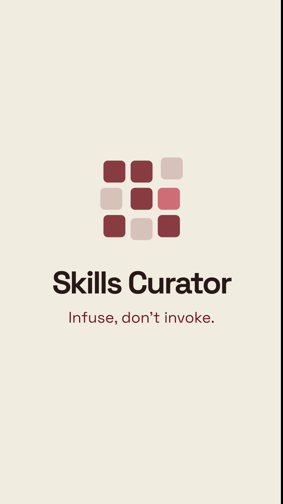
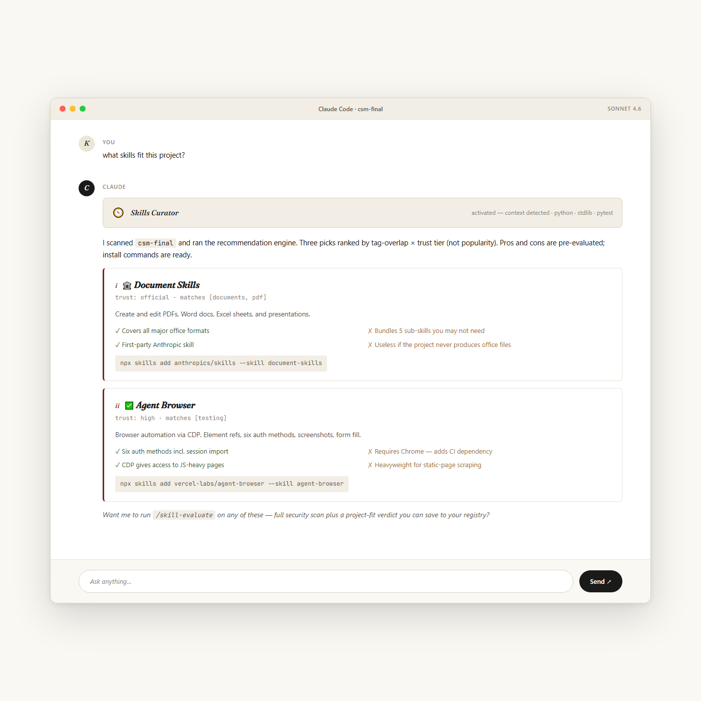
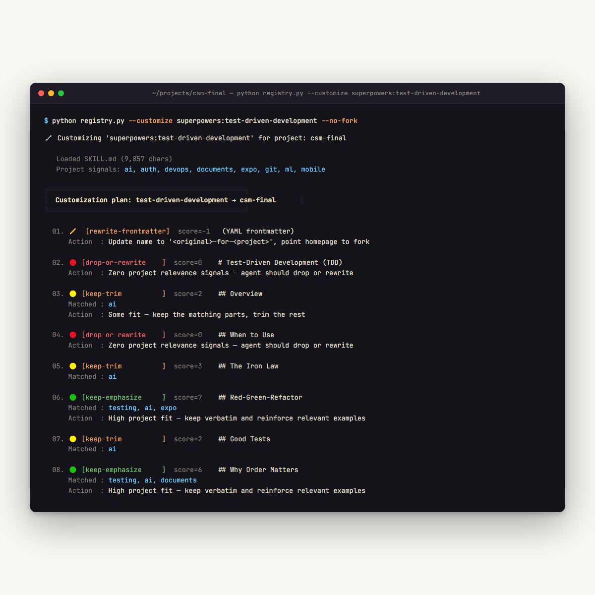

<div align="center">


# Skills Curator

**Install the skill. Customize it to your stack. Decide once, never re-decide.**

The intelligence layer for Claude skills — surfaces what fits your project, decomposes external skills into project-tailored forks, and persists every judgment.

[](https://github.com/captkernel/Skills_Curator/releases)
[](.github/workflows/validate.yml)
[](tests/)
[](#editions)
[](LICENSE)
[](https://github.com/captkernel/Skills_Curator/commits)

<a href="https://github.com/captkernel/Skills_Curator/raw/main/docs/video/skills-curator-reel.mp4">
  
</a>

*32 seconds: what it does, and why. — [9:16 reels](https://github.com/captkernel/Skills_Curator/raw/main/docs/video/skills-curator-reel.mp4) · [4:5 feed](https://github.com/captkernel/Skills_Curator/raw/main/docs/video/skills-curator-reel-4x5.mp4)*

**Status: Stable · v4.6.1 · 55 supported platforms · Three editions: Lite (default) · Python · claude.ai (web + desktop)**

</div>

---

## Install

**Claude Code (plugin, recommended):**
```
/plugin marketplace add captkernel/plugins
/plugin install skills-curator@captkernel
```
Other ways: the one-line installer below, a manual copy into `~/.claude/skills/`, or the claude.ai zip.

- **`--customize` forks a skill into your stack.** It splits an external SKILL.md into sections, scores each one against your project, and rewrites mismatched examples in your stack. The capability transfers; the author's accent doesn't.
- **Token cost is measured, not estimated.** 249 tokens always-on per session and at most 1,140 tokens per command, flat from an empty folder to a 17,680-file project ([report](docs/token-cost-report.html)).
- **Every decision persists.** Each evaluation (pros, cons, conflicts, verdict) is saved to a local registry, so re-asking about a skill costs about 13 tokens instead of about 4,060.

### Other ways to install

```bash
# One-liner (installs Lite by default, adds Python tier if Python 3.10+ is found):
npx skills add captkernel/Skills_Curator

# Or clone + run an installer (copies into ~/.claude/skills/ and ~/.claude/commands/):
git clone https://github.com/captkernel/Skills_Curator
cd Skills_Curator
bash install.sh                                      # auto; or --lite-only / --with-python
powershell -ExecutionPolicy Bypass -File install.ps1 # Windows (same modes via -Tier)
```

**Manual copy:** put `skills/skills-curator-lite/` (and, for the Python tier, `skills/skills-curator/`) in `~/.claude/skills/`, and `.claude/commands/*.md` in `~/.claude/commands/`.

**claude.ai (web + desktop):** download [`skills-curator-claudeai.zip`](https://github.com/captkernel/Skills_Curator/raw/main/dist/skills-curator-claudeai.zip) (19 KB), then upload it at claude.ai → **Settings → Capabilities → Skills → Upload skill**. To persist your registry, add an empty `skills_registry.json` to a Project's Knowledge. Full setup in [`INSTALL.md`](editions/skills-curator-claudeai/INSTALL.md).

After install, the skill auto-loads in any new Claude Code session and announces itself once on first activation.

---

## Editions

Three editions ship in one repo, targeting two different runtimes. Pick by **where you run Claude**, not by feature wish-list:

- **Claude Code (CLI)** → Lite (default) or Python (opt-in performance tier). The plugin installs both; `npx skills add` installs Lite and adds Python if 3.10+ is found.
- **claude.ai (web + desktop)** → claude.ai edition. Uploaded as a zip via Settings → Capabilities → Skills.

The three editions share the same judgment model and the same registry JSON schema (v3.0) — a registry written by one edition can be read by another. Lite needs no engine; the Python tier adds single-pass speed on 100+ skills, 37 regression tests and Gist sync; the claude.ai edition drops `PLATFORMS` / `MIGRATE` and saves forks as uploadable zips. Full side-by-side table: [`docs/reference.md`](docs/reference.md#editions-full-comparison).

---

## Demo

### Skills Curator activates in a real Claude Code session



The user asks *"what skills fit this project?"*. The skill activates, reads the project context, and weaves a ranked list with trust-tier icons, pros/cons, and install commands into the response. No prompting, no manual lookup. Sample `--recommend` output: [`docs/reference.md`](docs/reference.md#example---recommend-output).

---

## Why this exists

Existing skill tools (`npx skills`, `asm`, `vercel-labs/find-skills`) wait for you to ask. They solve plumbing — install, list, sync — and rely on you to know what to look for. **That's the wrong default**, because:

- You don't know what skills *exist* until you go searching.
- Popularity-ranked recommendations surface the same generic picks for everyone.
- You forget — six months later, you're re-evaluating a skill you already decided about.
- Every skill you bolt on imports its author's voice. Stack five external skills and your project speaks in five accents.

Skills Curator inverts the model. It's context-aware — reads what you're building and tells *you* what's worth considering. Recommendations refresh only when your project actually changes. And when you adopt a skill, `--customize` decomposes it first so it arrives in your project's voice, not the author's.

**The mental model shift: stop treating external skills as monolithic plugins to invoke. Treat them as capability libraries to absorb selectively.** Your project keeps one author. Yourself.

---

## Features at a glance

| | Other skill managers | **Skills Curator** |
|---|---|---|
| Install / list skills | ✅ | ✅ |
| **Context-aware** — recommendations match your stack, refresh on project change | ❌ | ✅ `--auto` |
| **Listens for symptoms** — *"slow tests"* → recommends test-perf skills | ❌ | ✅ `--symptoms` (17 patterns) |
| **Trust-rated catalog** — curated + live GitHub topic search | ⚠️ varies | ✅ 19 curated + live |
| **Pre-install evaluation** with pros / cons / conflicts / verdict | ❌ | ✅ Persisted forever |
| **Skill decomposition + project-voice rewrite** — adopt capability without inheriting voice | ❌ | ✅ `--customize` |
| **Pre-install security scan** — 15 risk patterns | ⚠️ post-install only | ✅ Pre-install, automatic |
| **Stack audit** — duplicates, conflicts, unreviewed skills, health scores | ❌ | ✅ One pass |
| **Cross-agent migration** with verified paths | ⚠️ partial | ✅ **55 platforms** |
| **Cross-device sync** via private GitHub Gist | ❌ | ✅ |
| **Bounded token cost** — engine reads project in subprocess, not Claude's context | ❌ | ✅ ([report](docs/token-cost-report.html)) |
| Honest about install counts (no fake popularity scraping) | ❌ | ✅ |

`--auto` re-runs recommendations only when your project's key files change, `--symptoms` maps complaints like *"my tests are slow"* to skill categories, and `--find` / `--discover` searches the catalog by keyword. More in [The intelligence layer](docs/reference.md#the-intelligence-layer).

---

## `--customize` — infuse, don't invoke



This is the unlock. The standard model — `npx skills add <author/skill>` — installs an external skill *as-is*: their examples, their stack assumptions, their voice. Your project then speaks with their accent.

`--customize` runs differently:

1. **Decomposes the source SKILL.md** into its constituent sections (frontmatter, when-to-use, patterns, examples, anti-patterns, etc.).
2. **Reads your project's stack** — languages, frameworks, deps, goals from CLAUDE.md.
3. **Scores every section** against that fingerprint and tags an action: `keep-emphasize`, `keep-trim`, `rewrite-stack`, `drop-or-rewrite`, or `rewrite-frontmatter`.
4. **Writes a forked SKILL.md** at `~/.claude/skills/<name>-for-<project>/SKILL.md` containing the plan.
5. **The agent rewrites each section in your project's voice** — keep high-fit material verbatim, rewrite stack-mismatched examples in your stack, drop irrelevant parts entirely.

**Result:** Vue snippets become React snippets. Django routes become FastAPI routes. The capability transfers. The author's accent doesn't.

### Concrete example

Run `--customize superpowers:test-driven-development` against a Python project:

```
01. ✏️ [rewrite-frontmatter] score=-1  (YAML frontmatter)
02. 🔴 [drop-or-rewrite   ] score=0   # Test-Driven Development (TDD)
03. 🟢 [keep-emphasize    ] score=7   ## Red-Green-Refactor
    Matched : testing, ai
04. 🟡 [keep-trim         ] score=2   ## Common Rationalizations
05. 🟢 [keep-emphasize    ] score=6   ## Why Order Matters
    Matched : testing, documents
```

High-fit sections (Red-Green-Refactor, Why Order Matters) get kept and emphasized. Narrative-only sections that don't ground in your project get dropped or rewritten. The frontmatter is renamed so the fork is clearly *yours-for-this-project*. The original author's contribution becomes invisible the way a great translator's does — the meaning transfers, the accent doesn't.

Run it with `python registry.py --customize <source>` (add `--no-fork` to preview the plan); `<source>` is a registered id, a local path, or `owner/repo@skill`.

---

## Token cost

249 tokens always-on per session and at most 1,140 tokens of stdout per command; project size has no measurable effect because the engine reads your files in a subprocess. Full table in [`docs/reference.md`](docs/reference.md#token-cost) and the [token cost report](docs/token-cost-report.html).

---

## Quickstart

In any Claude Code session, ask anything below — the skill activates automatically:

- *"Should I install agent-browser for this project?"* → evaluates against your CLAUDE.md, runs a security scan, gives ADOPT / PARTIAL / SKIP with evidence
- *"What skills would help this project?"* → scans your stack, ranks recommendations by fit, returns capability + preference splits with pros/cons
- *"Audit my skills"* → finds duplicates, preference conflicts, security-unreviewed community skills, stale versions, low health scores
- *"Migrate my skills to Cursor and Codex"* → multi-target copy, with safety checks for existing files

Slash commands: `/skill-evaluate`, `/skill-recommend`, `/skill-audit`. Architecture, the full command reference, platforms, FAQ, requirements and repository layout are in [`docs/reference.md`](docs/reference.md).

---

## Roadmap

- **v4.5** — Surface `--customize` hints directly in `--auto` and `--symptoms` output. Make the agent default to suggesting `--customize` over a raw install when the project's stack diverges from the source skill. Persist `_TRUSTED_AUTHORS` to a user config.
- **v4.6** — Skill-author helpers: `--validate-skill <path>` to scan your own SKILL.md against best practices. Bidirectional `--customize` — track when a forked skill drifts from the upstream source so you can pull future improvements without losing your rewrites.
- **v5.0** — Schema v4: snapshot the catalog at evaluation time so verdicts remain auditable even as the catalog moves on.

---

## Project status

**Stable.** v4.6.1 current; schema v3 (stable since v4.0). Lite (default, zero deps) + Python full (opt-in). CI runs 3 OS × 4 Python versions on every PR, with 37 pytest cases (Python tier). Catalog: 19 curated entries + live GitHub topic discovery (24h cache). 55 platforms, mirrored from `vercel-labs/skills`. MIT. Maintainer: [@captkernel](https://github.com/captkernel).

---

## What it runs, reads and sends

- **Runs.** Lite uses only the agent's Bash, Read, Glob, Grep and Write tools, plus `curl` to the GitHub search API (and to `raw.githubusercontent.com` when you customize a GitHub-hosted skill). The Python tier runs one stdlib-only script, `skills/skills-curator/scripts/registry.py`, as a subprocess.
- **Reads.** Your project's files (stack, dependencies, CLAUDE.md) and the skills installed under `~/.claude/skills`.
- **Writes.** Its own `registry.json` under `~/.claude/skills/` on your machine; a fork folder there when you run `--customize`; copies into other agents' skill folders when you run `--migrate`.
- **Sends.** Without Gist sync, only GET requests to GitHub: topic search on `api.github.com`, SKILL.md fetches from `raw.githubusercontent.com` when you customize or check a remote skill, and release lookups when you run `--stale`. Your code, project content and registry stay on your machine.
- **Gist sync is opt-in.** The Python tier pushes the registry to a private GitHub Gist only after you set `SKILLS_CURATOR_GIST_ID` and `SKILLS_CURATOR_GITHUB_TOKEN` and run `--push` or `--sync`. Setup: [`docs/gist-sync.md`](docs/gist-sync.md).

---

## Security

`registry.py` is stdlib-only Python. Optional network calls go to GitHub only (`api.github.com` for Gist sync, version checks and **catalog topic search**; `raw.githubusercontent.com` for SKILL.md fetches). **It never sends your code, project content, or registry contents to any external service.** `SKILLS_NO_TELEMETRY=1` turns off catalog search and SKILL.md fetches; `--stale` and Gist sync still connect when you run them.

The `--check` scanner is **conservative** — it flags patterns that *could* be dangerous even when benign (like `eval()` in a registry script). That's intentional. Review flagged files and decide; don't miss something.

See [SECURITY.md](SECURITY.md) for vulnerability reporting.

---

## Contributing

PRs welcome. High-value contributions: new `SECURITY_RISK_PATTERNS` (with justification + a test in `tests/test_security_scan.py`), high-trust `KNOWN_SKILLS` catalog entries with source link and pros/cons, new `FRAMEWORK_SIGNALS` / `GOAL_SIGNALS` for the project scanner, new `_TRUSTED_AUTHORS` entries, and verified `PLATFORMS` corrections with a doc URL.

See [CONTRIBUTING.md](CONTRIBUTING.md). All PRs must pass `pytest tests/` and `python registry.py --validate --strict`.

---

## License

[MIT](LICENSE).
